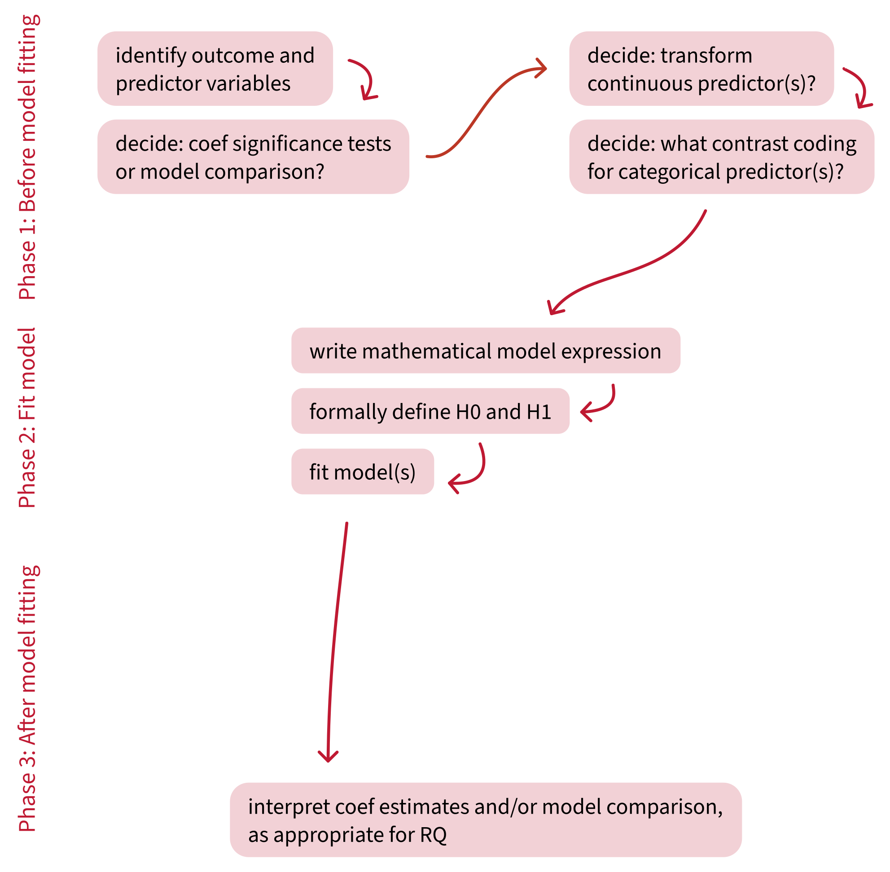
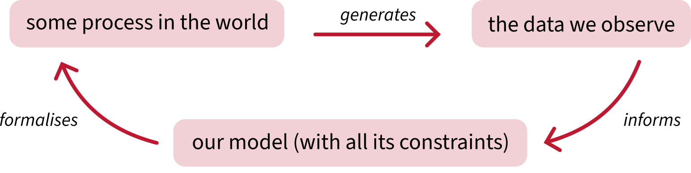
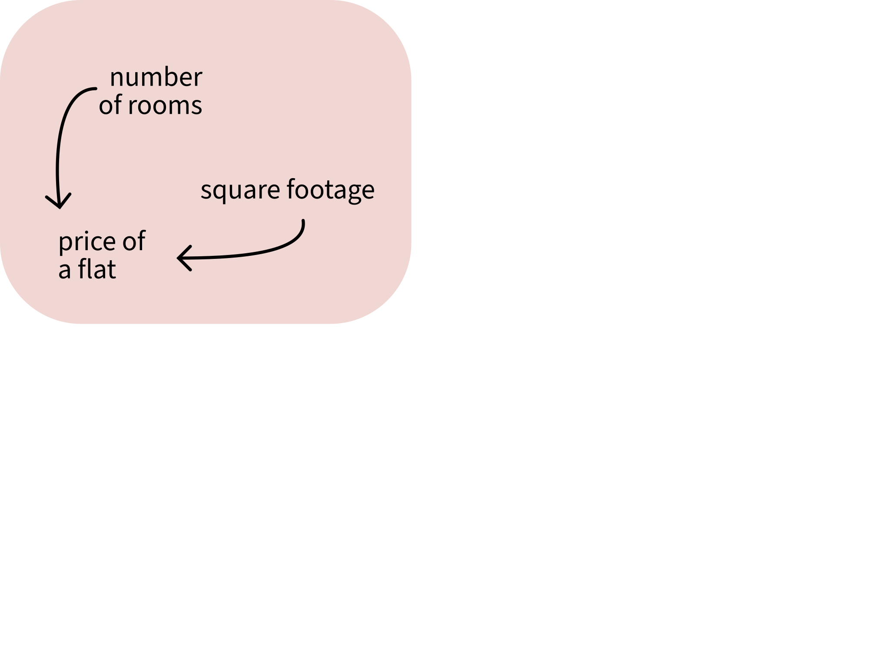
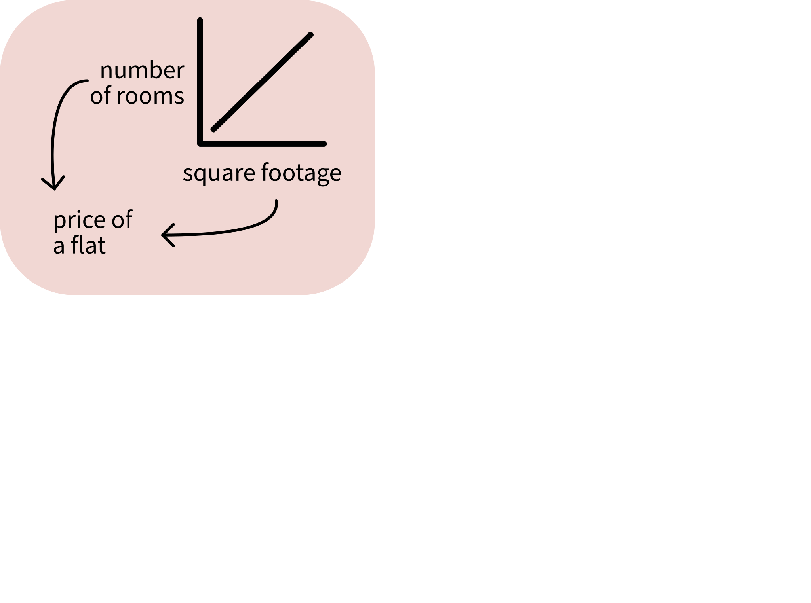
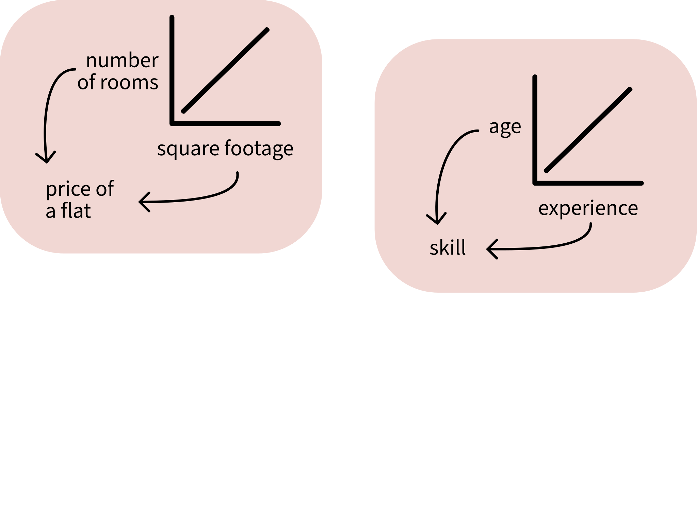
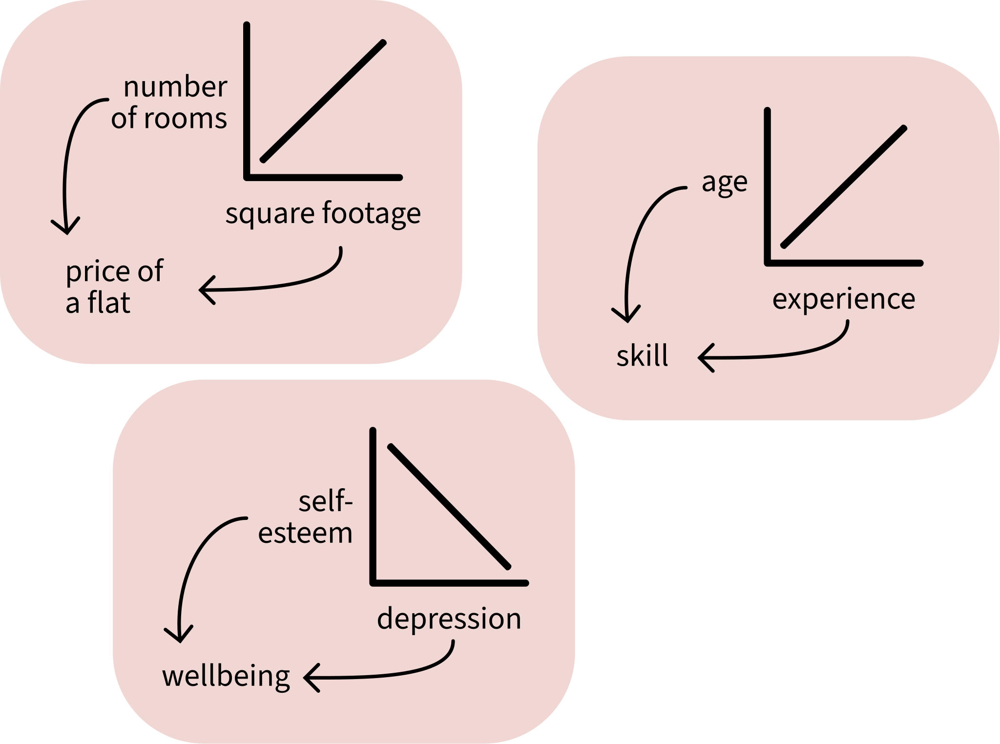
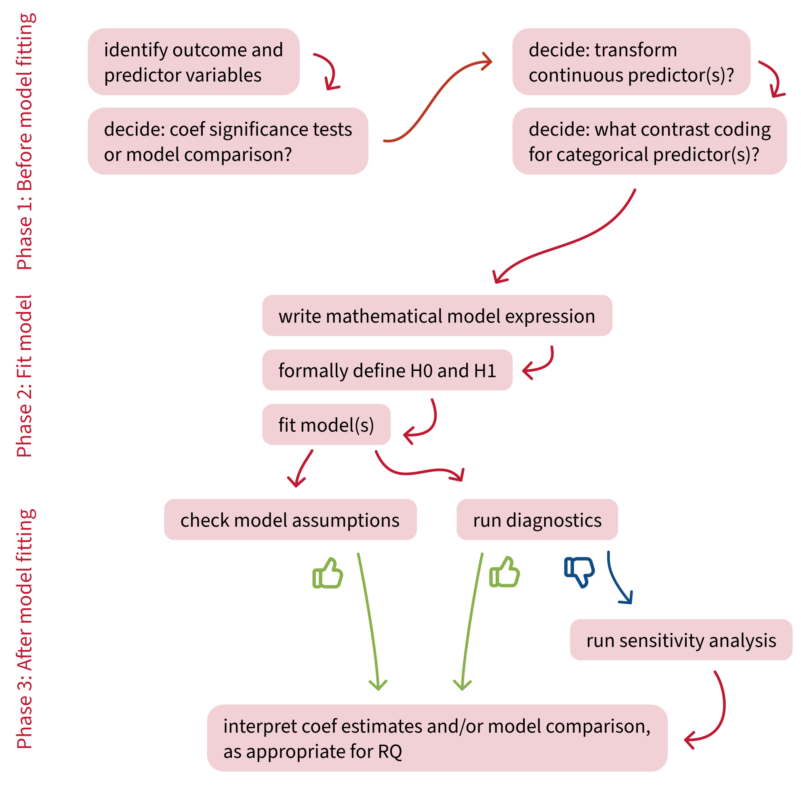

```{r setup, include = F}
library(tidyverse)
library(patchwork)
library(emmeans)
library(simglm)
source('../_theme/theme_quarto.R')

dapr2red <- "#BF1932" 
pal <- c("#3173c9", "#ff94b0", "#51b375")
```


# Course overview {background-color="white" style="font-size:80%;"}

<br>

:::: {.columns}
::: {.column width="50%"}

```{r echo = FALSE, results='asis', warning = FALSE}
source('../dapr2_course_outline.R')
source("https://raw.githubusercontent.com/uoepsy/junk/main/R/course_table.R")
course_table(block1_name, block2_name, block1_lecs, block2_lecs, week = 8)
```

:::

::: {.column width="50%"}

```{r echo = FALSE, results='asis', warning = FALSE}
course_table(block3_name, block4_name, block3_lecs, block4_lecs, week = 0)
```

:::
::::


## This week's learning objectives

<br>

::: {style="font-size: 125%;"}

::: {.fragment}
::: {.dapr2callout}
What assumptions do we have to make and accept in order to use a linear model?
:::
:::

::: {.fragment}
::: {.dapr2callout}
What property of a single data point might affect a linear model's estimates? 
How can we diagnose it?
:::
:::

::: {.fragment}
::: {.dapr2callout}
What relationship between predictors do we want to avoid? How can we diagnose it?
:::
:::

:::


## Building an analysis workflow

{fig-align="center"}

# Big picture: Why do we have to make assumptions?

## Why do we have to make assumptions?

<br>

{fig-align="center" height="250"}

<br>

**An example of a model's constraint:**

- Linear models can only model associations between predictors and outcomes as straight lines.
- We cannot change that the model uses straight lines only.
- So if we use linear models, we have to **assume** that a straight line is a reasonable way of representing the actual data generating process in the world.

<br>

**A model's unchangeable constraints = the assumptions that we must be satisfied with in order to use and interpret the model.**


# Assumptions

## What we must assume about the data

```{=html}
<table>
  <tr>
    <td></td>
    <td><b>Assumption</b></td>
    <td><b>Looks fine</b></td>
    <td><b>Suspicious</b></td>
  </tr>
  <tr>
    <td style="vertical-align: middle"><b>L</b></td>
    <td style="vertical-align: middle; visibility: hidden;"><b>Linearity:</b> The association between predictor and outcome is close enough to a straight line.</td>
    <td style="visibility: hidden;"></td>
    <td style="visibility: hidden;"></td>
  </tr>
  <tr>
    <td style="vertical-align: middle"><b>I</b></td>
    <td style="visibility: hidden;"><b>Independence:</b> Every data point's error is independent of every other data point's error. (Until DAPR3, we'll assume this is true as long as we have between-participant data.)</td>
    <td style="visibility: hidden;"></td>
    <td style="visibility: hidden;"></td>
  </tr>
  <tr>
    <td style="vertical-align: middle"><b>N</b></td>
    <td style="vertical-align: middle; visibility: hidden;"><b>Normally-distributed errors:</b> The differences between fitted line and each data point (i.e., the residuals) are close enough to following a normal distribution.</td>
    <td style="visibility: hidden;"></td>
    <td style="visibility: hidden;"></td>
  </tr>
  <tr>
    <td style="vertical-align: middle;"><b>E</b></td>
    <td style="vertical-align: middle; visibility: hidden;"><b>Equal variance of errors:</b> The differences between fitted line and each data point (i.e., the residuals) are dispersed by a similar enough amount across the whole range of the predictor.</td>
    <td style="visibility: hidden;"></td>
    <td style="visibility: hidden;"></td>
  </tr>
</table>
```

 <!-- visibility: hidden; in style tag-->
 
# L is for linear association

## **L**: The association between predictor and outcome is linear

<br>

```{r fig nonlin, message = FALSE, warning=F, echo=F, fig.asp = .5, fig.width = 12}
set.seed(221020)
quadr <- function(x, a, b, c){ a + b*x + c*x^2  }

x <- seq(-2, 2, length.out = 101)

df_nonlin <- tibble(
  y = abs(quadr(x + 0.5, 1, 0, 1) + rnorm(101, 0, 1)),
  x1 = abs(1 + (3 * y) + rnorm(101, 0, 1)),
  x2 = x
)
# pairs(df_nonlin)

p_good <- df_nonlin %>%
  ggplot(aes(x=x1, y=y)) +
  geom_point(size = 3) +
  geom_smooth(method = 'lm', se = FALSE, linewidth=2) +
  labs(
    title = 'Linear (straight line)'
  ) +
  theme(
    axis.text = element_blank(),
    axis.ticks = element_blank(),
    plot.title = element_text(size = 28),
  ) +
  NULL

p_quad <- df_nonlin |>
  ggplot(aes(x=x2, y=y)) +
  geom_point(size = 3) +
  geom_smooth(method = 'lm', se = FALSE, linewidth=2) +
  labs(
    y = element_blank(),
    title = 'Non-linear'
  ) +
  theme(
    axis.text = element_blank(),
    axis.ticks = element_blank(),
    plot.title = element_text(size = 28),
  ) +
  NULL

p_good + p_quad
```


<!-- ## Checking linearity with one predictor -->

<!-- Make a scatterplot with a straight line and a "LOESS" line (**LO**cally **E**stimated **S**catterplot **S**moothing). -->

<!-- :::: {.columns} -->
<!-- ::: {.column width="50%" style="font-size: 85%;"} -->

<!-- **The linear variable:** -->

<!-- ```{r fig.asp = .7, fig.width = 10, fig.align = 'center', warning=F, message=F} -->
<!-- df_nonlin |> -->
<!--   ggplot(aes(x=x1, y=y)) + -->
<!--   geom_point(size = 5) + -->
<!--   geom_smooth(method = 'lm', -->
<!--               colour = 'blue', se = FALSE, linewidth = 3) + -->
<!--   geom_smooth(method = 'loess', -->
<!--               colour = 'red', se = FALSE, linewidth = 3) -->
<!-- ``` -->


<!-- ::: -->
<!-- ::: {.column width="50%" style="font-size: 85%;"} -->

<!-- **The non-linear variable:** -->

<!-- ```{r fig.asp = .7, fig.width = 10, fig.align='center', warning=F, message=F} -->
<!-- df_nonlin |> -->
<!--   ggplot(aes(x=x2, y=y)) + -->
<!--   geom_point(size = 5) + -->
<!--   geom_smooth(method = 'lm', -->
<!--               colour = 'blue', se = FALSE, linewidth = 3) + -->
<!--   geom_smooth(method = 'loess', -->
<!--               colour = 'red', se = FALSE, linewidth = 3) -->
<!-- ``` -->

<!-- ::: -->
<!-- :::: -->

<!-- You want the LOESS line (`method = 'loess'`, red) to stick close to the straight line (`method = 'lm'`, blue). -->
<!-- Deviations suggest non-linearity. -->


## Checking linearity

<br>

If we have only categorical predictors, we don't have to check linearity.
We can just accept that we'll model the difference between group means using a straight line.

<br>

But for continuous predictors (in single/multiple regression models), we check linearity visually using **component–residual plots.**

- **"Component":** The association between one particular predictor and the outcome, with all the other predictors held constant.
  - Think of this as each predictor's individual contribution to the overall linear model.

- **"Residual":** The differences between the line the model predicts and the actual observed data points.

<br>

Basically, component–residual plots can look at the linearity of each association individually, without any of the other predictors getting in the way.


## Component–residual plots

<!-- A component–residual plot shows: -->

<!-- - **x axis:** a predictor across its full range -->
<!-- - **y axis:** that predictor's component + each data point's residual -->

```{r eval=F}
m1 <- lm(y ~ x1 + x2, data = df_nonlin)
car::crPlots(m1)
```


```{r fig.asp = .5, echo=F, fig.align = 'center'}
m1 <- lm(y ~ x1 + x2, data = df_nonlin)

car::crPlots(
  m1,
  cex.axis = 2,
  cex.lab = 1.5,
  cex = 2
  )
```

We want the wobbly pink line to match the straight blue line as closely as possible.
Deviations indicate non-linearity.

**We must decide: is the association linear *enough* that it's OK to model the association using a straight line?**

If we aren't willing to make this assumption: try transforming the predictor or outcome variables (e.g., using `log(y)` instead of just plain `y`, or `log(x2)` instead of just plain `x2`).
Then see if the deviation lessens.

<!-- This is a judgement call. There is no single correct answer. -->
<!-- You'll develop a clearer sense of this with time and experience. -->


<!-- ## What to do if we *don't* want to assume linearity -->

<!-- <br> -->

<!-- In order of increasing spiciness: -->

<!-- <br> -->

<!-- :::: {.columns} -->
<!-- ::: {.column width="25%"} -->
<!--  -->

<!-- ::: -->
<!-- ::: {.column width="75%"} -->
<!-- Report the non-linearity in your write-up (then your reader knows that your model's estimates are a bit less trustworthy). Totally fine if the deviation isn't huge. -->
<!-- ::: -->
<!-- :::: -->

<!-- :::: {.columns} -->
<!-- ::: {.column width="25%"} -->
<!-- ** ** -->
<!-- ::: -->
<!-- ::: {.column width="75%"} -->
<!-- Transform outcome or predictor until their association looks more linear (e.g., what if you take the exponential with `exp()`? the logarithm with `log()`?) -->
<!-- ::: -->
<!-- :::: -->

<!-- :::: {.columns} -->
<!-- ::: {.column width="25%"} -->
<!-- **  ** -->
<!-- ::: -->
<!-- ::: {.column width="75%"} -->
<!-- Beyond DAPR3: You can use so-called "higher-order" regression terms, which let you model particular kinds of curves (quadratic functions, cubic functions, etc.). -->
<!-- ::: -->
<!-- :::: -->

<!-- :::: {.columns} -->
<!-- ::: {.column width="25%"} -->
<!-- **  ** -->
<!-- ::: -->
<!-- ::: {.column width="75%"} -->
<!-- Beyond DAPR3: You can capture basically any non-linear relationship using "generalised additive models" (GAMs). -->
<!-- ::: -->
<!-- :::: -->

<br>


## What we must assume about the data

```{=html}
<table>
  <tr>
    <td></td>
    <td><b>Assumption</b></td>
    <td><b>Looks fine</b></td>
    <td><b>Suspicious</b></td>
  </tr>
  <tr>
    <td style="vertical-align: middle"><b>L</b></td>
    <td style="vertical-align: middle">
    <p><b>Linearity:</b> The association between predictor and outcome is close enough to a straight line.</p>
    </td>
    <td></td>
    <td></td>
  </tr>
  <tr>
    <td style="vertical-align: middle"><b>I</b></td>
    <td style="visibility: hidden;"><b>Independence:</b> Every data point's error is independent of every other data point's error. (Until DAPR3, we'll assume this is true as long as we have between-participant data.)</td>
    <td style="visibility: hidden;"></td>
    <td style="visibility: hidden;"></td>
  </tr>
  <tr>
    <td style="vertical-align: middle"><b>N</b></td>
    <td style="vertical-align: middle; visibility: hidden;"><b>Normally-distributed errors:</b> The differences between fitted line and each data point (i.e., the residuals) are close enough to following a normal distribution.</td>
    <td style="visibility: hidden;"></td>
    <td style="visibility: hidden;"></td>
  </tr>
  <tr>
    <td style="vertical-align: middle;"><b>E</b></td>
    <td style="vertical-align: middle; visibility: hidden;"><b>Equal variance of errors:</b> The differences between fitted line and each data point (i.e., the residuals) are dispersed by a similar enough amount across the whole range of the predictor.</td>
    <td style="visibility: hidden;"></td>
    <td style="visibility: hidden;"></td>
  </tr>
</table>
```


# I is for independence of errors

## **I**: Independence of errors

<br>

<!-- :::: {.columns} -->
<!-- ::: {.column width="50%"} -->

<!-- :::{.hcenter} -->
<!--  -->
<!-- ::: -->

<!-- <br> -->

<!-- **If you roll a 20-sided die at 9 am everyday,** you'll generate a lot of values between 1 and 20. -->

<!-- These values are totally unrelated to each other from one day to the next. -->

<!-- What you roll today is not correlated at all with the number you rolled yesterday. -->


<!-- ::: -->
<!-- ::: {.column width="50%"} -->

<!-- :::{.hcenter} -->
<!--  -->
<!-- ::: -->

<!-- <br> -->

<!-- **If you take the temperature in Edinburgh at 9 am everyday,** you'll also generate values between 1 and 20 (ish). -->

<!-- These values *are* related to each other from one day to the next. -->

<!-- A colder temperature yesterday is more likely to go with a colder temperature today. -->

<!-- This is an example of **autocorrelation**. -->

<!-- ::: -->
<!-- :::: -->

<!-- ## To check for autocorrelation -->

<!-- ```{r include=F} -->
<!-- # simulate dice-rolling data -->
<!-- set.seed(2023) -->
<!-- acf_lo <- sample(1:20, size = 30, replace = TRUE) -->

<!-- # simulate autocorrelated data -->
<!-- # source: https://stackoverflow.com/a/77090029  -->
<!-- acf.negbin <- function(N, mu, size, alpha, max.iter = 100, tol = 1e-5) { -->
<!--   m = length(alpha) -->
<!--   generate = function(){ -->
<!--    x = sort(rnbinom(N,size=size,mu=mu)) -->
<!--    y <- rnorm(length(x)) -->
<!--    x[rank(stats::filter(y, alpha, circular = TRUE))] -->
<!--   } -->
<!--   a = generate() -->
<!--   iter <- 0L -->
<!--   ACF <- function(x) acf(x, lag.max = m - 1, plot = FALSE)$acf[1:m] -->
<!--   SSE <- function(x,alpha) sum((ACF(x) - alpha)^2) -->
<!--   while ((SSE0 <- SSE(a, alpha)) > tol) { -->
<!--     if ((iter <- iter + 1L) == max.iter) break -->
<!--     a1 <- generate() -->
<!--     if(SSE(a1,alpha) < SSE0) a <- a1 -->
<!--   } -->
<!--   return(a) -->
<!-- } -->

<!-- set.seed(2023) -->
<!-- acf_hi <- acf.negbin( -->
<!--   30,           # how many obs to simulate -->
<!--   mu = 10,      # mean of simulated data -->
<!--   size = 5,     # dispersion parameter.  -->
<!--                 # the bigger, the tighter the data will cluster around the mean. -->
<!--   alpha=c(0.9, 0.8, 0.8, 0.8)  # target correl of points with lag = 1, 2, n -->
<!--   ) -->

<!-- autocorr_data <- tibble( -->
<!--   day = 1:30, -->
<!--   d20 = acf_lo, -->
<!--   temp = acf_hi-3 -->
<!-- ) -->
<!-- ``` -->

<!-- :::: {.columns} -->
<!-- ::: {.column width="50%"} -->

<!-- :::{.hcenter} -->
<!--  -->
<!-- ::: -->


<!-- ```{r echo=F} -->
<!-- autocorr_data |> -->
<!--   ggplot(aes(x = day, y = d20)) + -->
<!--   geom_point(size = 5) + -->
<!--   geom_line(linewidth = 2) + -->
<!--   ylim(1, 20) -->
<!-- ``` -->
<!-- ::: -->
<!-- ::: {.column width="50%"} -->

<!-- :::{.hcenter} -->
<!--  -->
<!-- ::: -->

<!-- ```{r echo=F} -->
<!-- autocorr_data |> -->
<!--   ggplot(aes(x = day, y = temp)) + -->
<!--   geom_point(size = 5) + -->
<!--   geom_line(linewidth = 2) + -->
<!--   ylim(1, 20) -->
<!-- ``` -->
<!-- ::: -->
<!-- :::: -->

<!-- ## To check for autocorrelation -->

<!-- The **autocorrelation function** (ACF) quantifies how much each data point is correlated with each data point that came before it. -->

<!-- **Lag**: How many data points are we looking back by? -->

<!-- :::: {.columns} -->
<!-- ::: {.column width="50%"} -->

<!-- ```{r fig.width=8, fig.asp = .7} -->
<!-- acf(autocorr_data$d20,  -->
<!--     cex.axis=1.7, cex.lab=1.6) -->
<!-- ``` -->

<!-- ::: -->
<!-- ::: {.column width="50%"} -->

<!-- ```{r fig.width=8, fig.asp = .7} -->
<!-- acf(autocorr_data$temp,  -->
<!--     cex.axis=1.7, cex.lab=1.6) -->
<!-- ``` -->
<!-- ::: -->
<!-- :::: -->


<!-- This was an illustration using autocorrelated **data points**. -->

<!-- Strictly speaking, the linear model assumes that it's the **errors**, not the data points, that are independent—but where data points are autocorrelated, then often the errors are too. -->


The most common source of non-independence is when multiple observations are gathered from the same source.

<br>

For example:

- many test scores gathered from the same schools,
- many reaction times gathered from the same participants,
- and so on.

<br>


:::{.dapr2callout style='font-size: 120%;' .fragment}
**Until DAPR3,** you can assume that errors are independent **as long as the experimental design is between-subjects** (i.e., as long as each person only contributes data to one experimental condition).
:::


<!-- ## What to do if errors are non-independent -->

<!-- <br> -->

<!-- In order of increasing spiciness: -->

<!-- <br> -->

<!-- :::: {.columns} -->
<!-- ::: {.column width="25%"} -->
<!-- **** -->
<!-- ::: -->
<!-- ::: {.column width="75%"} -->
<!-- Keep the variable as-is and report the non-independence in your write-up. -->
<!-- ::: -->
<!-- :::: -->

<!-- :::: {.columns} -->
<!-- ::: {.column width="25%"} -->
<!-- ** ** -->
<!-- ::: -->
<!-- ::: {.column width="75%"} -->
<!-- In DAPR3, you'll learn how to tell a model that some data points probably behave more like one another than they behave like others by including so-called "random effects". -->
<!-- ::: -->
<!-- :::: -->


## What we must assume about the data

```{=html}
<table>
  <tr>
    <td></td>
    <td><b>Assumption</b></td>
    <td><b>Looks fine</b></td>
    <td><b>Suspicious</b></td>
  </tr>
  <tr>
    <td style="vertical-align: middle"><b>L</b></td>
    <td style="vertical-align: middle;"><b>Linearity:</b> The association between predictor and outcome is close enough to a straight line.</td>
    <td></td>
    <td></td>
  </tr>
  <tr>
    <td style="vertical-align: middle"><b>I</b></td>
    <td><b>Independence:</b> Every data point's error is independent of every other data point's error. (Until DAPR3, assume this is true as long as you have between-participant data.)</td>
    <td></td>
    <td></td>
  </tr>
  <tr>
    <td style="vertical-align: middle"><b>N</b></td>
    <td style="vertical-align: middle; visibility: hidden;"><b>Normally-distributed errors:</b> The differences between fitted line and each data point (i.e., the residuals) are close enough to following a normal distribution.</td>
    <td style="visibility: hidden;"></td>
    <td style="visibility: hidden;"></td>
  </tr>
  <tr>
    <td style="vertical-align: middle;"><b>E</b></td>
    <td style="vertical-align: middle; visibility: hidden;"><b>Equal variance of errors:</b> The differences between fitted line and each data point (i.e., the residuals) are dispersed by a similar enough amount across the whole range of the predictor.</td>
    <td style="visibility: hidden;"></td>
    <td style="visibility: hidden;"></td>
  </tr>
</table>
```


# N is for normally-distributed errors

## **N**: Normally-distributed errors

<br>

```{r fig beta, message = FALSE, warning=F, echo=F, fig.asp = .5, fig.width = 12}
# draw errors from a beta distribution, so they're all skewed
set.seed(1)
beta_errors <- rbeta(101, shape1 = 1, shape2 = 50) |> 
  scale(scale = FALSE, center = TRUE) * 50

df_nonnorm <- tibble(
  x = seq(-2, 2, length.out = 101),
  y_norm = abs(4 + (2 * x) + rnorm(101, 0, 1)), 
  y_nonnorm = abs(4 + (2 * x) + beta_errors),
)

p_good <- df_nonnorm |>
  ggplot(aes(x=x, y=y_norm)) +
  geom_point(size = 5) +
  geom_smooth(method = 'lm', se = FALSE, linewidth = 2) +
  labs(
    y = 'y',
    title = 'Normal errors'
    ) +
  theme(title = element_text(size = 32)) +
  NULL

p_beta <- df_nonnorm |>
  ggplot(aes(x=x, y=y_nonnorm)) +
  geom_point(size = 5) +
  geom_smooth(method = 'lm', se = FALSE, linewidth = 2) +
  labs(y = 'y') +
  labs(
    y = element_blank(),
    title = 'Non-normal errors'
    ) +
  theme(title = element_text(size = 32)) +
  NULL

p_good + p_beta
```


The differences between the fitted line and each data point (aka the **residuals**) should be normally-distributed.

Check normality using **a Q-Q plot.**

```{r include=F}
m_norm <- lm(
  y_norm ~ x, 
  data = df_nonnorm
)

m_nonnorm <- lm(
  y_nonnorm ~ x, 
  data = df_nonnorm
)
```


<!-- ## 1. To check normality of errors: Histogram -->

<!-- We'll see two examples: one with normal errors (left) and one with non-normal errors (right). -->

<!-- With a histogram of the residuals, we can eyeball how normally-distributed they appear. -->

<!-- <br> -->

<!-- :::: {.columns} -->
<!-- ::: {.column width="50%"} -->

<!-- **Normally-distributed errors:** -->

<!-- ```{r} -->
<!-- tibble(residuals = m_norm$residuals) |>  -->
<!--   ggplot(aes(x = residuals)) + -->
<!--   geom_histogram() -->
<!-- ``` -->

<!-- Matches the bell curve shape pretty well. -->
<!-- ::: -->
<!-- ::: {.column width="50%"} -->

<!-- **Non-normally-distributed errors:** -->

<!-- ```{r} -->
<!-- tibble(residuals=m_nonnorm$residuals) |>  -->
<!--   ggplot(aes(x = residuals)) + -->
<!--   geom_histogram() -->
<!-- ``` -->

<!-- Very right-skewed! This is not a normal distribution. -->

<!-- ::: -->
<!-- :::: -->


## Q-Q plots (Quantile–Quantile plots)

Q-Q plots compare the model's residuals (dots) to what the residuals WOULD look like in a world where they were perfectly normally-distributed (diagonal line).
**We want the dots to closely match the diagonal line.**

:::: {.columns}
::: {.column width="48%"}

**Normally-distributed errors:**

```{r eval=F}
plot(m_norm, which = 2)
```

```{r fig.asp=.7, fig.width=7, echo=F, fig.align = 'center'}
par(mar = c(5, 5, 3, 0))  # bltr
plot(
  m_norm, which = 2, 
  cex.axis = 1.5,
  cex.lab = 1.5,
  cex.caption = 1.5,
  cex.id = 1.5,
  cex = 1.5
)
```

<!-- A few small divergences at the extremes. -->

:::
::: {.column width="4%"}
:::
::: {.column width="48%"}

**Non-normally-distributed errors:**

```{r eval=F}
plot(m_nonnorm, which = 2)
```

```{r fig.asp=.7, fig.width=7, echo=F, fig.align = 'center'}
par(mar = c(5, 5, 3, 0))  # bltr
plot(
  m_nonnorm, which = 2, 
  cex.axis = 1.5,
  cex.lab = 1.5,
  cex.caption = 1.5,
  cex.id = 1.5,
  cex = 1.5
)
```

<!-- Bottom left and top right diverge a *lot*! -->

:::
::::

**We must decide: is the distribution of errors normal enough that it's OK to model them using the linear model machinery?**

If we're not willing to make this assumption: 

- Transforming variables is often a good trick.
For example, does the situation improve if you model `log(y)` instead of just `y`?
- Or: bootstrap your model (more next week!).


<!-- ## What to do if errors are not normal -->

<!-- <br> -->

<!-- :::: {.columns} -->
<!-- ::: {.column width="25%"} -->
<!--   -->
<!-- ::: -->
<!-- ::: {.column width="75%"} -->
<!-- Transform outcome or predictor to make errors more normally distributed (e.g., if your distribution of errors is very right-skewed like in this example, taking the logarithm of the outcome is often a good trick). -->
<!-- ::: -->
<!-- :::: -->

<!-- :::: {.columns} -->
<!-- ::: {.column width="25%"} -->
<!--   -->
<!-- ::: -->
<!-- ::: {.column width="75%"} -->
<!-- Bootstrap your model's estimates. More on this next week! -->
<!-- ::: -->
<!-- :::: -->


## What we must assume about the data

```{=html}
<table>
  <tr>
    <td></td>
    <td><b>Assumption</b></td>
    <td><b>Looks fine</b></td>
    <td><b>Suspicious</b></td>
  </tr>
  <tr>
    <td style="vertical-align: middle"><b>L</b></td>
    <td style="vertical-align: middle;"><b>Linearity:</b> The association between predictor and outcome is close enough to a straight line.</td>
    <td></td>
    <td></td>
  </tr>
  <tr>
    <td style="vertical-align: middle"><b>I</b></td>
    <td><b>Independence:</b> Every data point's error is independent of every other data point's error. (Until DAPR3, assume this is true as long as you have between-participant data.)</td>
    <td></td>
    <td></td>
  </tr>
  <tr>
    <td style="vertical-align: middle"><b>N</b></td>
    <td style="vertical-align: middle;"><b>Normally-distributed errors:</b> The differences between fitted line and each data point (i.e., the residuals) are close enough to following a normal distribution.</td>
    <td></td>
    <td></td>
  </tr>
  <tr>
    <td style="vertical-align: middle;"><b>E</b></td>
    <td style="vertical-align: middle; visibility: hidden;"><b>Equal variance of errors:</b> The differences between fitted line and each data point (i.e., the residuals) are dispersed by a similar enough amount across the whole range of the predictor.</td>
    <td style="visibility: hidden;"></td>
    <td style="visibility: hidden;"></td>
  </tr>
</table>
```


# E is for equal variance of errors

## **E**: Equal variance of errors


```{r fig unequal, message = FALSE, warning=F, echo=F, fig.asp = .5, fig.width = 12}
set.seed(1)
inc_errors <- rnorm(101, mean = 0, sd = seq(0.1, 4, length.out = 101))

df_unequal <- tibble(
  x = seq(-2, 2, length.out = 101),
  y_equal = abs(4 + (2 * x) + rnorm(101, 0, 1)), 
  y_unequal = abs(4 + (2 * x) + inc_errors),
)

p_good <- df_unequal |>
  ggplot(aes(x=x, y=y_equal)) +
  geom_point(size = 5) +
  geom_smooth(method = 'lm', se = FALSE, linewidth = 2) +
  labs(
    y = 'y',
    title = 'Errors have\nequal variance'
    ) +
  theme(title = element_text(size = 32)) +
  NULL

p_unequal <- df_unequal |>
  ggplot(aes(x=x, y=y_unequal)) +
  geom_point(size = 5) +
  geom_smooth(method = 'lm', se = FALSE, linewidth = 2) +
  labs(y = 'y') +
  labs(
    y = element_blank(),
    title = 'Errors have\nunequal variance'
    ) +
  theme(title = element_text(size = 32)) +
  NULL

p_good + p_unequal
```

- Equal variance of errors is also called **"homoscedasticity"** or **"homogeneity of errors"**.
- Unequal variance of errors is also called **"heteroscedasticity"** or **"heterogeneity of errors"**.

When errors don't have equal variance, the model is not equally good at estimating the outcome for all values of the predictor.

**Check by plotting the residuals against the fitted (predicted) outcome values.**

```{r include=F}
m_equal <- lm(
  y_equal ~ x, 
  data = df_unequal
)

m_unequal <- lm(
  y_unequal ~ x, 
  data = df_unequal
)
```


## Residuals vs fitted plots

<!-- - **x axis:** the predicted outcome values (aka the "fitted values" across their whole range). -->
<!-- - **y axis:** the residuals of each data point. -->

We want to see a random-looking cloud of data points with the same vertical distance from 0 across the whole x axis.

:::: {.columns}
::: {.column width="48%"}
**Errors with equal variance:**

```{r eval=F}
plot(m_equal, which = 1)
```


```{r fig.asp=.6, fig.width=7, echo=F, fig.align = 'center'}
par(mar = c(5, 5, 3, 0))  # bltr

plot(
  m_equal, which = 1, 
  cex.axis = 1.5,
  cex.lab = 1.5,
  cex.caption = 1.5,
  cex.id = 1.5,
  cex = 1.5
)
```
:::
::: {.column width="4%"}
:::
::: {.column width="48%"}
**Errors with unequal variance:**

```{r eval=F}
plot(m_unequal, which = 1)
```


```{r fig.asp=.6, fig.width=7, echo=F, fig.align = 'center'}
par(mar = c(5, 5, 3, 0))  # bltr

plot(
  m_unequal, which = 1, 
  cex.axis = 1.5,
  cex.lab = 1.5,
  cex.caption = 1.5,
  cex.id = 1.5,
  cex = 1.5
)
```
:::
::::

**We must decide: is the variance of errors equal enough that it's OK to model the data using the linear model machinery?**

If you are not willing to make this assumption:

- Check if the model is misspecified (e.g., are you missing important covariates or interactions?). Fitting a more suitable model might tidy up the unequal variance.
- Bootstrap the model (more next week!)

## Residuals vs fitted plots also check linearity

Sometimes component-residual plots aren't possible (e.g., in Block 3 when our models contain interactions).

In those cases, we'll check linearity of association using the residuals vs fitted plots.

We want the red line to be straight and flat, closely matching the (tiny) dotted black line at y = 0.

<br>

:::: {.columns}
::: {.column width="48%"}
```{r eval=F}
plot(m_equal, which = 1)
```

```{r fig.asp=.6, fig.width=7, echo=F, fig.align = 'center'}
par(mar = c(5, 5, 3, 0))  # bltr

plot(
  m_equal, which = 1, 
  cex.axis = 1.5,
  cex.lab = 1.5,
  cex.caption = 1.5,
  cex.id = 1.5,
  cex = 1.5
)
```
:::
::: {.column width="4%"}
:::
::: {.column width="48%"}

```{r eval=F}
plot(m_unequal, which = 1)
```


```{r fig.asp=.6, fig.width=7, echo=F, fig.align = 'center'}
par(mar = c(5, 5, 3, 0))  # bltr

plot(
  m_unequal, which = 1, 
  cex.axis = 1.5,
  cex.lab = 1.5,
  cex.caption = 1.5,
  cex.id = 1.5,
  cex = 1.5
)
```
:::
::::

Same question as always: based on these plots, are we willing to accept that the association is linear enough that a linear model can tell us something useful about our data?


## What we must assume about the data

```{=html}
<table>
  <tr>
    <td></td>
    <td><b>Assumption</b></td>
    <td><b>Looks fine</b></td>
    <td><b>Suspicious</b></td>
  </tr>
  <tr>
    <td style="vertical-align: middle"><b>L</b></td>
    <td style="vertical-align: middle;"><b>Linearity:</b> The association between predictor and outcome is close enough to a straight line.</td>
    <td></td>
    <td></td>
  </tr>
  <tr>
    <td style="vertical-align: middle"><b>I</b></td>
    <td><b>Independence:</b> Every data point's error is independent of every other data point's error. (Until DAPR3, assume this is true as long as you have between-participant data.)</td>
    <td></td>
    <td></td>
  </tr>
  <tr>
    <td style="vertical-align: middle"><b>N</b></td>
    <td style="vertical-align: middle;"><b>Normally-distributed errors:</b> The differences between fitted line and each data point (i.e., the residuals) are close enough to following a normal distribution.</td>
    <td></td>
    <td></td>
  </tr>
  <tr>
    <td style="vertical-align: middle;"><b>E</b></td>
    <td style="vertical-align: middle;"><b>Equal variance of errors:</b> The differences between fitted line and each data point (i.e., the residuals) are dispersed by a similar enough amount across the whole range of the predictor.</td>
    <td></td>
    <td></td>
  </tr>
</table>
```

<br>


Making assumptions is not an absolute science, and there are no right/wrong answers.

**$\rightarrow$ Look at and describe the plots, motivate your reasoning, and you'll be fine.**


<!-- ================================================== -->

# Diagnostics

## Diagnostics to run on the data

<br>

:::: {.columns}
::: {.column width="50%" style="font-size: 125%;" }

Diagnosing unusual properties of <br> individual data points <br> (aka "case diagnostics"):

- High influence

:::
::: {.column width="50%" style="font-size: 125%;" }

Diagnosing undesirable relationships <br> between predictors:

- Multicollinearity


:::
::::


# High influence

<!-- ## High influence -->

<!-- A single observation might influence our model's estimates more than it should if  -->

<!-- - it has an unusual value for the outcome variable (i.e., if it's an outlier), -->
<!-- - it has an unusual value for the predictor variable (i.e., if it has high leverage), -->
<!-- - or both. -->

<!-- <br> -->

<!-- ::::{.columns} -->
<!-- :::{.column width="33%"} -->
<!-- **Outlier:** -->

<!--  -->
<!-- ::: -->
<!-- :::{.column width="33%"} -->
<!-- **High leverage:** -->

<!--  -->
<!-- ::: -->
<!-- :::{.column width="33%"} -->
<!-- **Outlier with high leverage:** -->

<!--  -->
<!-- ::: -->
<!-- :::: -->


## How can one point influence a model?

<br>

```{r fig infl, message = FALSE, warning=F, echo=F, fig.asp = .5, fig.align='center', fig.width = 12}
set.seed(221020)

n_obs <- 32

df_infl <- tibble(
  x = seq(-2, 2, length.out = n_obs),
  y_good = abs(4 + (2 * x) + rnorm(n_obs, 0, 1)),
  y_infl = y_good,
)

df_infl <- rbind(
  df_infl,
  tibble(
    x = -1.5, y_good = NA, y_infl = 9.5
  )
) |>
  slice_sample(n = n_obs+1)

p_good <- df_infl |>
  ggplot(aes(x=x, y=y_good)) +
  geom_point(size = 5) +
  geom_smooth(method = 'lm', se = FALSE, linewidth = 2) +
  labs(
    y = 'y',
    title = "If it's removed, the line\nmoves down!"
    ) +
  theme(title = element_text(size = 24)) +
  NULL

p_infl <- df_infl |>
  ggplot(aes(x=x, y=y_infl)) +
  geom_point(size = 5) +
  geom_smooth(method = 'lm', se = FALSE, linewidth = 2) +
  labs(y = 'y') +
  labs(
    y = element_blank(),
    title = 'A dataset with one\ninfluential observation'
    ) +
  theme(title = element_text(size = 24)) +
  NULL

p_infl + p_good
```


To see how much each data point influences the model's estimates, we use a measure called **Cook's distance.**


## Cook's distance

<br>

Cook's distance measures **the average distance that the predicted outcome values will move, if a given data point is removed** (mathy details in back matter).


```{r include=F}
m_infl <- lm(y_infl ~ x, df_infl)
m_good <- lm(y_good ~ x, df_infl)
```

<br>

Find each data point's Cook's distance using `cooks.distance()`:

```{r}
cooks.distance(m_infl) |> head()
```

<br>

::::{.columns}
:::{.column width="30%"}

Or, more usefully, make a plot:

```{r eval=F}
plot(
  m_infl,
  which = 4
)
```
:::
:::{.column width="70%"}

```{r echo=F, fig.width = 7, fig.height = 4, fig.align = 'center'}
plot(
  m_infl,
  which = 4,
  cex.axis = 1.5,
  cex.lab = 1.5,
  cex.caption = 1.5,
  cex.id = 1.5,
  cex = 1.5
)
```
:::
::::


Data point 25 has by far the greatest influence on the model's estimates.


## Vote: What to do if you find unusual data points

<br>

  &nbsp;  &nbsp; Ignore them and pretend they don't exist?

<br>

:::{.fragment}
  &nbsp; &nbsp; Check if they could be a mistake?
:::

<br>
 
:::{.fragment}
  &nbsp; &nbsp; Delete them?
:::

<br>

:::{.fragment}
 &nbsp; &nbsp; Mention them in your write-up?
:::

<br>

:::{.fragment}
  &nbsp; &nbsp; Replace them with less extreme values?
:::

<br>

:::{.fragment}
  &nbsp; &nbsp; Check how much they influence your conclusions?
:::


# Sensitivity analysis

## Sensitivity analysis

<br>

A sensitivity analysis asks: **Do our conclusions change if we leave out the unusual data point?**

Specific coefficient values will almost definitely change, but **our actual conclusions are usually based on (a) the direction of the slope estimate and (b) whether or not we reject its H0 at our chosen $\alpha$ level, usually .05.**

- If our conclusions don't change, then the influential data point doesn't actually matter, regardless of how big its Cook's distance is.
- If our conclusions DO change, then we need to 
  - report this as a limitation of our analysis and
  - draw our conclusions based on the newer model.

<br>

We saw that the influential data point is in row 25, so we will remove that one row from the data and re-fit the model.

```{r}
m_infl_sens <- lm(
  y_infl ~ x, 
  data = df_infl[-25,]  # "subtract" row 25 (notation: [rownum, colnum])
)
```


## Compare coefficient estimates

<br>

From the original model, fit to the data that **contains** the high-influence value: 

```{r echo=F}
cat('', paste0(capture.output(
  summary(m_infl)
), '\n')[9:12])
```

<br>

From the new model, fit to the data with the high-influence value **removed**:


```{r echo=F}
cat('', paste0(capture.output(
  summary(m_infl_sens)
), '\n')[9:12])
```


<br>

The values of the coefficients do change a bit, but the association is still positive, and it's still significant.

**$\rightarrow$ Even though the high-influence point had a big Cook's Distance, it doesn't affect our conclusions.**

So we could just write something like 

> One observation had a much higher Cook's distance than all the others, but a sensitivity analysis showed that this observation does not affect the direction of associations or the pattern of significance of our results.


# Multicollinearity

## Multicollinearity

::: {.r-stack}
{.fragment height="600" }

{.fragment height="600" }

{.fragment height="600" }

{.fragment height="600" }

:::

:::{.fragment}

When two predictors are correlated, they contain similar information.

**If you know one, you can guess the other.**

The model cannot tell which predictor is contributing what information, so its estimates are less precise.

Technically speaking, **the variance of its estimates increases,** and a significant result is less likely.

:::


<!-- ## Correlated predictors -->

```{r include=F}
set.seed(1)

n_obs <- 101
corr_x1y  <- 0.8
corr_x2y  <- 0.6
# corr_x1x2 <- 0.9  # vif = 5.3
corr_x1x2 <- 0.93   # vif = TBD

corr_df <- MASS::mvrnorm(
  n = n_obs,
  mu = c(0, 0, 0),
  Sigma = matrix(
    c(1, corr_x1y, corr_x2y,
     corr_x1y, 1, corr_x1x2,
     corr_x2y, corr_x1x2, 1),
    nrow = 3),
  empirical = TRUE
  )

colnames(corr_df) <- c('y', 'x1', 'x2')
corr_df <- as_tibble(corr_df)
```


## Variance Inflation Factor (VIF)

<br>

We measure how much the variance has been inflated by correlated predictors using the **Variance Inflation Factor** or VIF.

VIF measures **how much the standard error of a predictor is increased by correlations with other predictors** (mathy details in the back matter).

<br> 

Intepreting VIF:

- **Close to 1 is ideal.**
- **Below 5 is low,** no need to worry.
- **Between 5 and 10 is moderate,** start to worry here.
- **More than 10 is severe,** very not good.

If VIF > 5, remove one of the correlated predictors (it's not adding anything new anyway), or combine them into a composite score (more on this in DAPR3!)


## VIF in R


Here's a dataset that I simulated to have highly correlated predictors `x1` and `x2`:

::::{.columns}
:::{.column width="50%"}

```{r}
corr_df |> head(8)
```

:::
:::{.column width="50%"}

```{r fig.width = 5, fig.height = 4}
#| code-fold: true

corr_df |>
  ggplot(aes(x = x1, y =  x2)) +
  geom_point(size = 3)
```
:::
::::

We calculate the Variance Inflation Factor in R using `vif()` from the package `car`.

Fit a model and compute its VIF:

```{r}
m_corr <- lm(y ~ x1 + x2, data = corr_df)
car::vif(m_corr)
```

VIF > 5, which means that **the variance in the model is much bigger with both predictors included than it would be if either one of them were left out.**


# Building an analysis workflow

## Building an analysis workflow

{fig-align="center"}


## Building an analysis workflow {visibility="uncounted"}

{fig-align="center"}


# Back matter {.appendix}

## Revisiting this week's learning objectives

::: {.dapr2callout}
**What must we assume is true about our data, in order to use a linear model?**

- Linearity: The association between predictor and outcome is close enough to a straight line.
- Independence: Every data point is independent of every other data point.
- Normally-distributed errors: The differences between fitted line and each data point (i.e., the residuals) are close enough to following a normal distribution.
- Equal variance of errors: The differences between fitted line and each data point (i.e., the residuals) are dispersed by a similar enough amount across the whole range of the predictor.
:::


::: {.dapr2callout}
**What property of a single data point might affect a linear model's estimates? 
How can we diagnose it?**

- High influence: an unusual value for the outcome and/or the predictor. 
- Diagnose using Cook's Distance.
:::

::: {.dapr2callout}
**What relationship between predictors do we want to avoid? How can we diagnose it?**

- We want to avoid predictors being highly correlated with one another. If they are, we call the situation "multicollinearity".
- When predictors are highly correlated, they contain very similar information, so the model is very uncertain how each one individually is associated with the outcome.
- Diagnose multicollinearity with the Variance Inflation Factor (VIF).
:::


## This week 

<br>

::::{.columns}
:::{.column width="50%"}
**Tasks:**

<br>

{width=80px style="margin:10px;margin-bottom:-50px"} Work on exercises in labs

<br>

{width=80px style="margin:10px;margin-bottom:-45px"} Complete the weekly quiz 


:::

:::{.column width="50%"}
**Get support:**

<br>

{width=80px style="margin:10px;margin-bottom:-30px"}
Consult the [flash cards](https://uoepsy.github.io/dapr2/2627/flashcards/){target="_blank"}

<br>

{width=80px style="margin:10px;margin-bottom:-50px"}
Ask questions anonymously on Piazza

<br>

{width=80px style="margin:10px;margin-bottom:-40px"} 
We really like seeing you in office hours!

:::
::::


## Cook's Distance: Intuition

<br>

Cook's distance is essentially **outlyingness $\times$ leverage**.

<br>

```{=html}
<table>
  <tr>
    <td>small outlyingness</td>
    <td>x</td>
    <td>small leverage</td>
    <td>=</td>
    <td>small influence</td>
  </tr>
  
  <tr>
    <td>small outlyingness</td>
    <td>x</td>
    <td><b>BIG</b> leverage</td>
    <td>=</td>
    <td><b>BIG</b> influence</td>
  </tr>
    
  <tr>
    <td><b>BIG</b> outlyingness</td>
    <td>x</td>
    <td>small leverage</td>
    <td>=</td>
    <td><b>BIG</b> influence</td>
  </tr>

  <tr>
    <td><b>BIG</b> outlyingness</td>
    <td>x</td>
    <td><b>BIG</b> leverage</td>
    <td>=</td>
    <td><b>VERY BIG</b> influence</td>
  </tr>
</table>
```


## Cook's Distance: Mathy details

<br>

**Cook's Distance** of a data point $i$:


$$D_i = \frac{(\text{StandardizedResidual}_i)^2}{k+1} \times \frac{h_i}{1-h_i}$$

Where

$$\frac{(\text{StandardizedResidual}_i)^2}{k+1} = \text{Outlyingness}$$

and

$$\frac{h_i}{1-h_i} = \text{Leverage},$$

So 

$$D_i = \text{Outlyingness} \times \text{Leverage}.$$


## VIF: Mathy details

<br>

$\sqrt{\text{VIF}}$ = how many times larger the standard error (SE) of each predictor is, compared to a version of the model without the other predictors.

<br> 

The thresholds of 5 and 10:

  - $\sqrt{5} = 2.24$, so SE is 2.24 times bigger than it would be if we removed the correlated predictors.
  - $\sqrt{10} = 3.16$, so SE is 3.16 times bigger than it would be if we removed the correlated predictors.

<br>

For a given predictor $x_j$, VIF is calculated as:  

$$
VIF_j = \frac{1}{1-R_j^2} \\
$$
